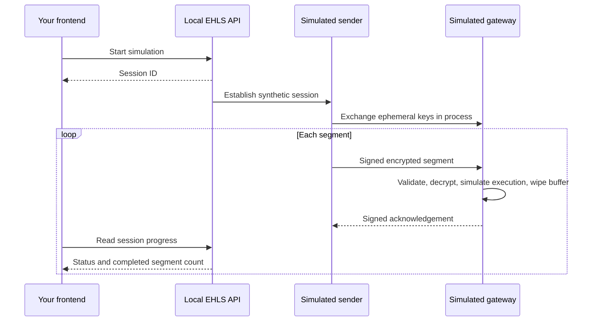

# EHLS Protocol

**Ephemeral Hardware-Locked Streaming** delivers manufacturing instructions as encrypted segments bound to a machine identity and a session. The intended lifecycle is: verify the machine, deliver a segment, execute it, clear its working buffer, and acknowledge completion before advancing.

**Try it through your own frontend.** This repository includes a local simulator service, a dependency-free JavaScript client, an interactive browser example, and the underlying Python protocol library.

The service currently simulates the server and receiving gateway in one process. It uses real encryption, message signatures, sequencing checks and managed-buffer wiping. Machine enrollment and physical execution are synthetic. **No printer is required or controlled.**

## Why I built EHLS

EHLS started with a problem I faced while developing 3D-printable fixed-wing drones. I wanted to sell my designs, but each one represented hundreds of hours of work across design, simulation, physical testing and electronics integration. The STL files were only one part of that investment.

I did not want to commercialise that work simply by selling the STL files. Once someone had the geometry, they could retain it, copy it and redistribute it independently of me. I wanted to explore a way for a customer to manufacture a design while keeping control over how the manufacturing instructions were delivered.

That led me to develop **Ephemeral Hardware-Locked Streaming**: an approach intended to bind instruction delivery to a particular machine and session, stream instructions in bounded encrypted segments, and clear working buffers as execution progresses. The goal was to sell access to manufacturing a design without handing over a reusable STL file.

I later explored commercialising the approach for spare-parts manufacturing across a number of sectors. Those efforts did not prove commercially viable, and I moved on from pursuing it as a business.

I am sharing the protocol because it may still be useful beyond the applications I explored. There could be opportunities around collecting manufacturing telemetry and execution data, or using the approach as a form of digital rights management (DRM) for machine instructions in other settings. I would be interested to see what others make of it.

The original business did not work out, but someone else may see an application I have not considered. The code is available under the MIT licence so others can inspect it, experiment with it and build on it.

## Start in a few minutes

Install Git and **Python 3.11+**, then clone:

```sh
git clone https://github.com/lorcan10/ehls-protocol.git
cd ehls-protocol
```

**Windows / PowerShell:**

```powershell
py -3.11 -m venv .venv
.\.venv\Scripts\python.exe -m pip install ".[api]"
.\.venv\Scripts\ehls.exe serve
```

**macOS / Linux:**

```sh
python3 -m venv .venv
.venv/bin/python -m pip install '.[api]'
.venv/bin/ehls serve
```

Open **[http://localhost:8765](http://localhost:8765)** and paste the temporary API token printed in your terminal. Click **Start simulation** to watch segment progress. Click **Cancel session** to exercise cleanup.

Interactive API documentation is available at **[http://localhost:8765/docs](http://localhost:8765/docs)**. The **Authorize** button accepts the same API token.

The service requests memory locking by default and fails a session if the OS refuses it. For an explicitly unlocked development simulation, append `--no-memory-lock` to `ehls serve`. The browser's session details report `memory_lock_requested: false` in that mode.

## Plug into React, Vue, or any JavaScript frontend

From your frontend project, install the client from your local clone (adjust the path):

```sh
npm install ../ehls-protocol/sdk/javascript
```

The package is provided in this repository; it has **not** been published to npm.

```js
import { EHLSClient } from 'ehls-protocol-client';

// token is supplied at runtime, e.g. entered in your local developer UI.
const ehls = new EHLSClient({ baseUrl: 'http://localhost:8765', token });
const session = await ehls.startSimulation({ segmentCount: 5 });

const result = await ehls.waitForSession(session.session_id, {
  onUpdate: session => {
    console.log(session.status, session.progress, session.last_event);
    // React: setSession(session); Vue: currentSession.value = session;
  },
});

if (result.status === 'failed') console.error(result.error);
```

The same client supports `getSession(id)` and `cancelSession(id)`. Progress uses polling; it requires no WebSocket setup or frontend framework.

Local frontend origins on ports **5173** and **3000** are allowed by default. Configure `EHLS_ALLOWED_ORIGINS` for other origins. Keep the service token out of source control and public frontend bundles. A hosted application should use its authenticated backend as a proxy and enforce user/session permissions there.

Read the **[integration guide](docs/INTEGRATION.md)** for Docker setup, a plain HTML example, API requests, configuration and troubleshooting.

## What happens in a session?



The API gives your frontend session controls and progress. Protocol keys and instruction contents are kept behind the service boundary. The service currently generates synthetic instructions; it does not accept STL uploads or execute user G-code.

## What is included?

| Path | Purpose |
| --- | --- |
| `ehls/` | Optional local REST service, simulator and packaged browser example |
| `sdk/javascript/` | JavaScript client usable from browsers or Node 18+ |
| `shared/models.py` | Identity, challenge, session, packet, segment and telemetry models |
| `shared/identity_artefacts.py` | Canonical MIP hashing input and passive comparison |
| `shared/crypto.py` | HKDF, X25519, AES-GCM, hashes and HMAC |
| `shared/protocol.py` | JSON/base64 encoding and packet signatures |
| `shared/kdf_constants.py` | Domain-separation constants and segment AAD |
| `shared/secure_memory.py` | Managed buffers, locking and wipe lifecycle |
| `gateway/` | Two platform memory helpers; no printer-control agent |
| `examples/local_stream.py` | Original command-line, in-process demonstration |
| `tests/` | Protocol, API, simulator and memory-helper tests |

The original `shared` and `gateway` import names are retained for traceability. Product portals, the private cloud service, printer drivers, geometry vault, deployment secrets, customer data and private Git history are excluded. See [source provenance](docs/PROVENANCE.md).

## Limitations and next steps

- **Simulator first:** physical identity checks, printer execution and telemetry correlation need an adapter. The first planned hardware target is K1C/Moonraker; it is not included yet. See the [adapter roadmap](docs/INTEGRATION.md#next-printer-adapter).
- **Local developer service:** one process owns all sessions, with one shared API token. There are no user accounts, tenant isolation, durable sessions or automatic resume. Restarting loses session state. Run a single worker.
- **Identity is not attestation:** hardware fingerprints are not secret keys. Identity-derived mode is recomputable when its inputs are known. X25519 keys also need authenticated exchange in a distributed deployment.
- **Memory guarantees are bounded:** managed-buffer wiping cannot erase every Python, crypto-library, transport or printer copy. It does not prove whole-system non-persistence or secure key destruction.
- **Simulated ACKs are not physical evidence:** a real adapter must distinguish command acceptance from execution and handle uncertain outcomes before retrying.
- **TEE backends are stubs:** SGX, TrustZone and SEV-SNP have no runtime implementation.

The [protocol guide](docs/PROTOCOL.md) documents exact encodings, key derivation, authentication responsibilities and memory boundaries.

## Run checks or use only the library

Use the Python executable in your virtual environment:

```sh
python -m pip install -e '.[api,dev]'
python -m pytest -q
node --test sdk/javascript/client.test.js
python -m examples.local_stream
```

The API is optional. Install `.` without extras to use only the underlying protocol library.

## Security

See [security boundaries and reporting](SECURITY.md) for the publication review, supported scope and private vulnerability reporting. Never commit real service tokens or printer credentials.

## License

[MIT](LICENSE).
