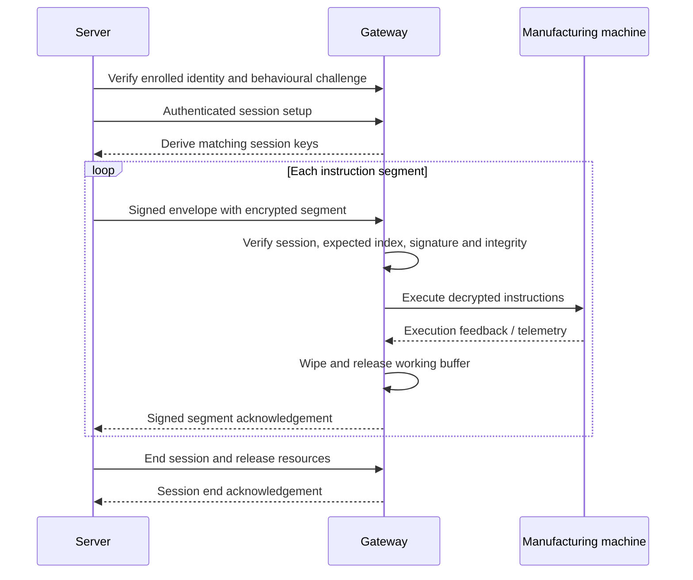

# EHLS Protocol

**Ephemeral Hardware-Locked Streaming** is a protocol for delivering manufacturing instructions in encrypted segments bound to a machine identity and a session. The intended lifecycle is: verify the machine, deliver a segment, execute it, destroy its working buffer, and acknowledge completion before advancing.

This repository publishes the **Python protocol core** extracted from EHLS: identity models, key derivation, encryption, signed messages, and memory helpers. It also includes an in-process demonstration and automated tests. It is a reference library, not a complete printer application.

## How it works



The diagram describes the intended deployment lifecycle. This extraction supplies the data structures and primitives; the server and gateway enforce the lifecycle in a complete deployment. The local example simulates execution and acknowledgements without contacting a printer.

1. **Identify the machine.** A Machine Identity Profile (MIP) describes passive identifiers. A Behavioural Identity Profile (BIP), represented by `BehaviouralBaseline`, records measured responses to an active challenge.
2. **Establish a session.** HKDF-SHA256 derives a 32-byte session key. The library supports identity-derived keys and an X25519 alternative that adds an ephemeral shared secret. The example uses X25519.
3. **Encrypt a segment.** AES-256-GCM protects instruction bytes. Authenticated data binds the session ID and segment index; an additional HMAC covers the IV, ciphertext and authenticated data.
4. **Authenticate messages.** HMAC-SHA256 signs the canonical JSON packet envelope. Receivers must also enforce session identity, sequence, and freshness.
5. **Execute and clear.** The gateway should correlate execution feedback, wipe its managed working buffer, and then acknowledge the segment. Memory helpers support OS page locking and explicit overwriting.

Read the [protocol guide](docs/PROTOCOL.md) for the exact encodings, key derivations, integration responsibilities, and limitations.

## Run the demonstration

Requires **Python 3.11 or later**.

```sh
git clone https://github.com/lorcan10/ehls-protocol.git
cd ehls-protocol
python3 -m venv .venv
source .venv/bin/activate
python -m pip install -e '.[dev]'
python -m examples.local_stream
python -m pytest -q
```

On Windows, create the environment with `py -3.11 -m venv .venv`, activate it with `.venv\Scripts\Activate.ps1` in PowerShell, and use `python` for the remaining commands.

The example creates three small synthetic segments in memory. It demonstrates matching session keys, encrypted transport serialization, signature checks, simulated execution, buffer overwriting, signed ACKs, and rejection of a duplicate segment. It sends no commands to hardware and writes no instruction files.

The default example requests a strict memory lock and stops if the OS refuses it. For an explicitly unlocked development simulation:

```sh
python -m examples.local_stream --no-memory-lock
```

This option does not demonstrate locked-memory enforcement.

## Code map

| Path | Purpose |
| --- | --- |
| `shared/models.py` | Packet types, identity, challenge, session, segment and telemetry models |
| `shared/identity_artefacts.py` | Canonical MIP hashing input and passive comparison |
| `shared/crypto.py` | HKDF, X25519, AES-GCM, hashes and HMAC |
| `shared/protocol.py` | JSON/base64 serialization and packet signatures |
| `shared/kdf_constants.py` | Domain-separation constants and segment AAD format |
| `shared/secure_memory.py` | Managed buffers, locking and wipe lifecycle |
| `gateway/` | Only the two platform memory helpers needed by `SecureBuffer` |
| `examples/local_stream.py` | Local demonstration with a simulated receiver |
| `tests/` | Protocol, cryptography and memory-helper tests |

The original `shared` and `gateway` import names are retained for traceability. The publication excludes the product portals, website, cloud service, printer drivers, geometry vault, deployment configuration, credentials, customer data, and private Git history. [Source provenance](docs/PROVENANCE.md) describes the extraction.

## Security and implementation boundaries

- Machine fingerprints bind keys to identity data; they are not hardware attestation or secret key material. If all identity-mode derivation inputs are known, its session key can be recomputed. Authenticate the handshake and protect its transport. X25519 public keys must also be authenticated.
- Serialization does not verify signatures. Applications must call verification and reject invalid messages before acting on them. Signatures and AAD do not independently prevent replay; receivers must track session state and expected indices.
- Memory locking applies to the allocated working buffer. Python strings, immutable `bytes`, cryptography-library internals, and transport/printer buffers can contain additional copies. This code does **not** establish whole-process secure erasure or prove that an instruction can never reach persistent storage.
- A simulated ACK is not physical execution evidence. A complete deployment needs a printer-specific execution verifier, telemetry correlation, fail-closed recovery, authenticated transport, and operating-system controls for swap, dumps and logs.
- SGX, TrustZone and SEV-SNP backends are named **stubs** and are not implemented.

## License

Published under the [MIT License](LICENSE).
